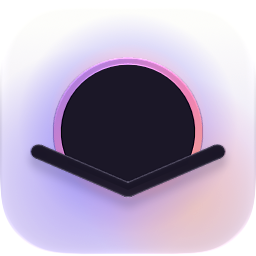
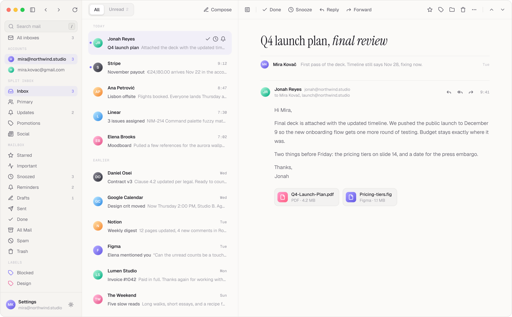

<div align="center">
  <picture>
    <source media="(prefers-color-scheme: dark)" srcset=".github/assets/icon-dark.png" />
    
  </picture>

  <h1>Nimbra</h1>

  <p><strong>Blazing fast mail. No bloat.</strong></p>

  <p>
    A native email client for macOS, written in Rust and drawn on the GPU with <a href="https://www.gpui.rs">GPUI</a>.<br />
    Every action is one key, your mail stays on your Mac, and there is nothing in it you didn’t ask for.
  </p>

  <p>
    
    
    
    
  </p>

  <p>
    <a href="#features">Features</a> ·
    <a href="#get-started">Get started</a> ·
    <a href="#connect-your-mail">Connect your mail</a> ·
    <a href="#keys">Keys</a> ·
    <a href="#privacy-and-security">Privacy</a> ·
    <a href="#development">Development</a>
  </p>
</div>

<p align="center">
  <picture>
    <source media="(prefers-color-scheme: dark)" srcset=".github/assets/showcase-dark.png" />
    
  </picture>
</p>

## Features

- **Fast by nature.** Native Rust, drawn on the GPU, no Electron. Mailboxes open from an encrypted local store and refresh in the background, so the app opens straight into your mail.
- **One key for everything.** `E` done, `H` snooze, `R` reply, `S` star, `/` search, `Z` undo. Hints show the key only while it would do something, and `?` lists them all.
- **Split inbox.** Important, Team, Calendar, Newsletters and Other, plus Starred, Snoozed, Reminders, Drafts, Sent, Done and your labels.
- **Snooze and reminders.** Quick times, or any day and time from the calendar; “Only if nobody replies” turns a snooze into a reminder. Works for Gmail and IMAP.
- **Block senders.** Their mail goes straight to a Blocked label and never notifies. It uses the same label as Spark, so a list kept there carries on.
- **Every account in one place.** Several Gmail and IMAP accounts, All inboxes merged newest first, and replies that go out from the right address.
- **Writing that gets out of the way.** A formatted editor, address suggestions, attachments by drag and drop, drafts that save themselves, undo send and send later.
- **Works offline.** Archive, star, read and send while offline; Nimbra sends it all once it can.
- **Light and dark,** with emails darkened to match in dark mode, and an app icon with every macOS appearance (light, dark, clear and tinted).

## Get started

```sh
cargo run
```

Without an account set up, or with `NIMBRA_DEMO=1`, Nimbra runs on built-in sample data and never touches the network.

To build the Mac app:

```sh
./scripts/bundle-macos.sh
open target/bundle/Nimbra.app
```

This builds the release binary and wraps it in `Nimbra.app` with the app icon. It needs Xcode 26 or newer. The script signs the app with your Developer ID or Apple Development certificate if one is in the keychain (override with `NIMBRA_SIGN_IDENTITY`). Signing matters for day-to-day use: macOS ties Keychain permission to the app's signature, so an unsigned build asks for the Keychain after every rebuild. For development, `./scripts/run-dev.sh` builds, signs and runs the debug binary the same way.

GPUI is built with the `runtime_shaders` feature, so Xcode's Metal toolchain is not required.

## Connect your mail

### Gmail

1. In Google Cloud Console, create a project, enable the Gmail API, and create an OAuth client of type "Desktop app". Keep the consent screen in Testing mode and add yourself as a test user.
2. Put the client in `~/.config/nimbra/oauth.env` (mode 600), never in the repo:

   ```sh
   NIMBRA_GOOGLE_CLIENT_ID=...
   NIMBRA_GOOGLE_CLIENT_SECRET=...
   ```

3. `cargo run`, then click **Connect Gmail**. Google opens in your browser.

Nimbra asks for the `gmail.modify` scope only. It covers reading, archiving, labelling and sending; it does not allow permanent deletion (the first permanent delete in Trash asks Google for that permission, and every one asks for confirmation). Nimbra sends only when you press Send. Signing in again takes only that same Google account: another one picked in the browser is refused before anything is saved.

Your Google profile photo comes from the People API (turn it on in your Cloud project), which tells your own photo from the letter Google draws.

### Other providers

**Add account** takes Google, or any address with a password (Zoho, iCloud, Fastmail, Yahoo, a company's own server). Nimbra finds the servers from the address (or you type them), checks that both take the password, and keeps the password in the keychain. A custom domain hosted at Google, Microsoft or Zoho is recognised from its mail (MX) records.

Such an account's folders are its labels and archiving moves to its Archive folder. New mail arrives at once where the server can say so (IMAP IDLE), and only what changed is asked for (CONDSTORE).

Outlook.com, Hotmail and Microsoft 365 sign in with Microsoft in the browser (**Continue with Microsoft**). That needs `NIMBRA_MICROSOFT_CLIENT_ID` (an app registered with Microsoft) in `~/.config/nimbra/oauth.env`; the sign-in is kept in the keychain, and IMAP and SMTP use it (XOAUTH2).

### Several accounts

Switch from the Accounts list in the sidebar or in Settings › Accounts. Each account has its own sign-in in the keychain and its own encrypted store and key; Sign out removes only that account. One account is the default (Settings › Accounts › Make default): its profile is at the bottom of the sidebar and new messages are from it.

With two or more accounts the sidebar adds **All inboxes**: every account's inbox merged, newest first, loading further as you scroll. Every account is checked for new mail and notifies, snoozes and scheduled sends run for all of them, and the Dock badge counts them all. In All inboxes, actions and replies go to the message's own account; labels stay per account.

## Keys

| Key | Action |
| --- | --- |
| `J` / `K` or arrows | Next / previous thread |
| `←` | Move the keys to the sidebar (a hidden sidebar comes in until you leave it); `↑` `↓` or `J` `K` walk its rows, `→` or `↵` opens one, `esc` goes back to the list |
| `Home` / `End` (or `⌘↑` / `⌘↓`) | First / last thread, or sidebar row |
| `X` | Pick or unpick the open thread |
| `⇧↑` / `⇧↓` (or `⇧K` / `⇧J`) | Pick more threads from the open one |
| `O` | Open the thread in its own window |
| `Space` / `⇧Space` | Page down / up through the message |
| `G` then `I` `S` `B` `T` `D` `A` | Go to Inbox, Starred, Snoozed, Sent, Drafts, All mail |
| `⌘1` … `⌘9` | All inboxes, then each account (with one account, `⌘1` is the Inbox) |
| `?` | Every shortcut on one sheet |
| `E` | Mark done (clear them all to reach Inbox Zero) |
| `Z`, `⌘Z` or `Ctrl+Z` | Undo the last archive, move or trash (an Undo pill also appears for a few seconds) |
| `/` or `⌘F` | Search (Enter runs it, `esc` clears it) |
| `S` | Star or unstar |
| `U` | Mark the open thread as unread, or read again |
| `H` or `⌘K` | Snooze menu |
| `V` | Switch between the reader view and the email's original formatting |
| `C` / `R` | Compose a new message / reply to the open thread |
| `⌘↵` | Send (in the composer) |
| `⌘⇧F` | Full-page composer on or off |
| `⌫` or `⌘⌫` | Move to trash |
| `⌘⇧L` | Toggle light and dark |
| `⌘B` | Show or hide the sidebar (hidden, it floats in when the pointer reaches the window's left edge) |
| `⌘⇧B` | Show or hide the message list (drag its right edge to resize it) |
| `⌘[` / `⌘]` | Back / forward through opened threads |
| `⌘W` | Close the window; Nimbra keeps running and checking mail (`⌘Q` quits) |
| `⌘R` or pull the list down | Check for mail |
| Right-click a thread | Mark read or unread, star, mark done, trash, report spam, open in Gmail |

## Privacy and security

- **Your mail stays on your Mac.** Nimbra talks straight to Gmail or your IMAP and SMTP servers; there is no server of its own in between.
- **Encrypted at rest.** Mailboxes, opened threads, counts, the offline queue and snoozes are kept in `~/Library/Application Support/Nimbra/store`. Each record is encrypted with ChaCha20-Poly1305 using a key kept only in the system keychain (`nimbra` / `store-key`); the files alone, or a backup of them, are unreadable. Search results are never stored. When a Google sign-in ends, that account's store and its key are deleted; a keychain that cannot be read deletes nothing.
- **Secrets in the Keychain.** Sign-ins, refresh tokens and passwords live only in the system keychain. OAuth client files stay in `~/.config/nimbra`, never in the repo.
- **Locked-down email.** Mail is drawn natively by default, with scripts, styles and forms dropped. **Show original** (`V`) renders the email's own HTML in a system web view with scripts off, navigation blocked, and remote scripts, frames, fonts and forms blocked by a content security policy; mail that tries to send you somewhere by itself (a meta refresh) is stopped. Only `http`, `https` and `mailto` links are clickable, and they open in your browser when you click them.
- **Remote images.** In the reader view they stay hidden until you click **Load images**, and tracking pixels are never loaded. The original view shows them by default (senders can then tell the mail was opened); **Block images** turns them off for the open thread.
- **TLS everywhere.** IMAP and SMTP use rustls with certificates always checked.

## How it works

<details>
<summary><strong>Checking for mail</strong></summary>

While the app is open it reads Gmail's change feed every 30 seconds (or 1 or 5 minutes, set in Settings › General): only what changed since the last look is fetched, the open mailbox is updated in place, and a macOS notification (sender and subject) is shown for each thread with a new unread inbox message. Clicking a notification opens that email. Notifications need the bundled `Nimbra.app` and your permission, and only arrive while Nimbra is running.

Clicking a mailbox shows what is kept at once and asks Gmail only if something changed since it was last checked or that was over a minute ago. The content of the first 3 threads of the open mailbox is fetched ahead and stored, so opening those is instant (more would run into Gmail's limit of 6,000 units a minute). A full fetch only happens when there is no starting point yet, the point is older than Gmail keeps (about a week), or the mailbox is a search, and then only threads that changed since they were last listed are read again. The mail store keeps the newest 300 threads per mailbox, with full text for the newest 100.

</details>

<details>
<summary><strong>Reading</strong></summary>

HTML mail opens in its original formatting by default; `V` switches to the native reader view and back. In dark theme, light emails get a dark page and light text, with pictures and brand colours kept; Nimbra's own script does this in an isolated WebKit world, and **Settings › Reading › Darken emails in dark theme** turns it off. Printing is always light.

Each message shows its sender and recipients; click the recipients line for From, To, Cc, Reply-To and the full date. Earlier messages in a thread have their own Reply, Reply all and Forward. Attachments can be previewed with Quick Look or saved to Downloads. Mailing lists get an Unsubscribe button beside the subject; spam is flagged with a Not spam button. Double-click a thread to open it in a window of its own; Return reads it in full view.

</details>

<details>
<summary><strong>Organising</strong></summary>

Opening a thread marks it read. `E` archives it (in Done, `E` moves it back to the inbox), `⌫` moves it to the trash, and `Z` undoes either. Threads show their labels (click × to remove one), the tag button adds a label or creates one, and the folder button moves a thread to the inbox, a label or Spam. The + next to Labels creates a label (“Parent/Child” nests it), and right-clicking a label renames or deletes it. ⌘-click and Shift-click pick several threads (⌘A picks all), and one Undo brings a batch back.

`/` or ⌘F opens search: matches from the mail on this Mac appear as you type, and the server's own results join a moment later. Search uses Gmail's syntax (`from:ana has:attachment newer_than:7d`).

</details>

<details>
<summary><strong>Snooze and reminders</strong></summary>

`H` (or ⌘K, or the clock in the toolbar or on a row) opens the Snooze menu: later today, tomorrow, tomorrow evening, this weekend or next week, each with the time it comes back, or **Pick a date** for a calendar: click a day and press Snooze (or Return). Its Time row opens a field to type any time in (“4:45 PM”, “16:45”, “430p”; a bare 1 to 7 is the afternoon) and the hours from 6 AM to 9 PM as shortcuts. The **Only if nobody replies** switch makes any of them a reminder.

Snoozed threads leave the inbox and come back unread with a notification; a reply that arrives first brings the thread back by itself and ends the snooze, as in Gmail, and a reminder only comes back if nobody replied. Snoozed and Reminders list every account's snoozes with the time each comes back. Each snooze is kept on this Mac with its own account, because Gmail's API has no snooze and IMAP has none at all, and happens while Nimbra is running (anything due while it was closed comes back when it opens).

</details>

<details>
<summary><strong>Blocking senders</strong></summary>

**Block sender** (in the reading pane's ⋯ menu) moves the open thread to a Blocked label, made if the account has none, which is where Spark files blocked mail, and blocks the sender's address for that account. Their new mail goes straight to Blocked, marked read, and never notifies; what they left in the inbox goes too. The first time each account is opened, the senders already in its Blocked label are blocked as well. Undo takes the sender off the list again, and **Unblock sender** (on a thread in Blocked) moves it back to the inbox. The list is kept on this Mac, so mail that arrives while Nimbra is closed is moved when it opens.

</details>

<details>
<summary><strong>Writing and sending</strong></summary>

Messages are written in a formatted editor: bold (⌘B), italic (⌘I), underline (⌘U), links (⌘K), bulleted and numbered lists, quotes. They are sent with both an HTML and a plain-text version, and pasted text keeps simple formatting only. Replies and forwards include the original message, folded behind •••; a forward also takes the original's attachments. With several accounts, a new message or a forward can be sent from any of them.

The composer has Cc and Bcc, suggests addresses from your mail as you type, and takes attachments from the paperclip or by dropping files on it (25 MB in total). Drafts save themselves a moment after you stop typing. Sending waits six seconds so you can undo it (⌘Z). From Send until the server has it, a message is kept encrypted on this Mac: quitting sends it first, and one that could not leave is sent when its account next connects. **Send later** sends the saved draft at the chosen time while Nimbra is running.

Offline, archive, star, read and the like still work: changes are kept (encrypted, on this Mac) and sent once the server can be reached, and an Offline pill shows how many are waiting.

</details>

## Design

The design lives in the [Mail Client Figma file](https://www.figma.com/design/s6tsR2l2X4MKmoA1dNlm4I/Mail-Client?node-id=7313-2):

- **Nimbra — App UI:** the screens as built (the inbox in dark and light, the Snooze menu, Compose, Inbox zero), the colour variables and text styles, and the component kit.
- **Landing:** the landing page.
- **Brand · App icon:** the icon and its Icon Composer layers.

### App icon

The icon source is `assets/AppIcon.icon`, an Icon Composer document (SVG layers plus `icon.json`); the same file works for iOS. Its layers are designed in the Figma file's “Icon Composer layers · 1024” board (one 1024×1024 frame per layer, inside the Light, Eclipse and Flap groups) and exported from there as SVG into `assets/AppIcon.icon/Assets`.

`icon.json` gives it all of macOS's appearances: Default is the light icon (a cream-to-lavender background, the flap and disc in ink, a softer glow), Dark is the violet-to-black one with the paper-white flap, and Clear and Tinted hide the glow and the dark disc, so the mark is a ring over an envelope flap. Layers that use glass must be filled shapes: outline strokes in Figma before exporting, because an open stroke is filled as a closed shape.

Render a preview from the command line (`--rendition` takes `Default`, `Dark`, `ClearLight`, `ClearDark`, `TintedLight` or `TintedDark`):

```sh
"/Applications/Xcode.app/Contents/Applications/Icon Composer.app/Contents/Executables/ictool" \
  assets/AppIcon.icon --export-image --output-file icon.png \
  --platform macOS --rendition Default --width 512 --height 512 --scale 1
```

Settings › About shows `assets/app-icon.png` in light mode and `assets/app-icon-dark.png` in dark mode, and this README shows `.github/assets/icon-light.png` and `icon-dark.png`. After changing the icon, render them again with the command above (`--rendition Default` for the light ones, `--rendition Dark` for the dark ones; 192 px for the app, 256 px for the README).

## Development

### Screenshot states

`NIMBRA_SCREEN=palette`, `zero`, `loading`, `compose`, `compose-full`, `snooze` or `snooze-time` opens that screen directly on the sample data. `NIMBRA_THEME=light` starts in light mode. `NIMBRA_SIDEBAR=closed` (or `open`) starts with the sidebar hidden or docked. `NIMBRA_OPEN=<row>` opens that thread first. `NIMBRA_READER=1` starts in the native reader view. `NIMBRA_SEARCH=<query>` starts with a search run. `NIMBRA_SHIFT=<px>` moves the window sideways.

### Live tests

The IMAP and SMTP code has live tests against local Dovecot and Mailpit servers (OrbStack or Docker); see `tasks/todo.md` for the setup. Run them with `NIMBRA_TEST_CA=certs/ca.pem cargo test live -- --ignored`.

### Sidebar blur

The sidebar is translucent and blurs whatever is behind the window. GPUI's own blurred window mode did not blur on macOS 27, so `src/blur.rs` asks the macOS window server directly through a private API. That is fine for now but is a risk for App Store review. Windows and Linux fall back to GPUI's built-in behaviour.

### Layout

- `src/theme.rs`: colours for dark and light, fonts, gradients
- `src/mail.rs`: the mail model every provider gives the app (threads, messages, labels, changes, errors, building a message to send), and the `Provider` interface the app calls
- `src/gmail.rs`: OAuth sign-in (PKCE, loopback redirect), keychain storage, Gmail REST calls
- `src/imap_mail.rs`: accounts that are not Gmail: IMAP folders as labels, threads from reply headers, a local index as the change feed, SMTP for sending
- `src/smtp.rs`, `src/tls.rs`, `src/mime.rs`: SMTP sending, TLS for both (rustls, certificates always checked), and turning raw mail into the model
- `src/microsoft.rs`: Microsoft sign-in (OAuth with PKCE, no secret) and its tokens
- `src/servers.rs`, `src/discover.rs`, `src/dns.rs`: an account's servers and its password in the keychain; finding the servers from an address (presets, autoconfig, MX records)
- `src/store.rs`: the encrypted on-disk mail store
- `src/blocking.rs`: blocked senders and the Blocked label
- `src/scheduled.rs`, `src/sending.rs`: send later, and a message from Send until the server has it
- `src/checking.rs`, `src/arrival.rs`, `src/quitting.rs`, `src/leaving.rs`: checks for mail, Inbox Zero at launch, and what quitting has to finish
- `src/rich.rs`, `src/webview.rs`: HTML or plain-text mail as styled blocks, and the locked-down web view behind Show original
- `src/app.rs`: the app's state, key actions and the window's layout; the rest of the `Nimbra` type continues in `accounts.rs`, `mailbox.rs`, `threads.rs`, `labels.rs`, `finder.rs`, `composer.rs`, `outgoing.rs` and `menus.rs`
- `src/sidebar.rs`, `src/list.rs`, `src/reading.rs`, `src/snooze_menu.rs`, `src/palette.rs`: the sidebar, the thread list (with Inbox Zero), the reading pane, the Snooze menu and the command palette
- `src/ui.rs`, `src/input.rs`: shared building blocks and the text field
- `assets/`: the app icon, bundled Sora and Geist Mono fonts (OFL) and Lucide-style icons

## License

Nimbra will be open source. A license will be added before the first public release.
